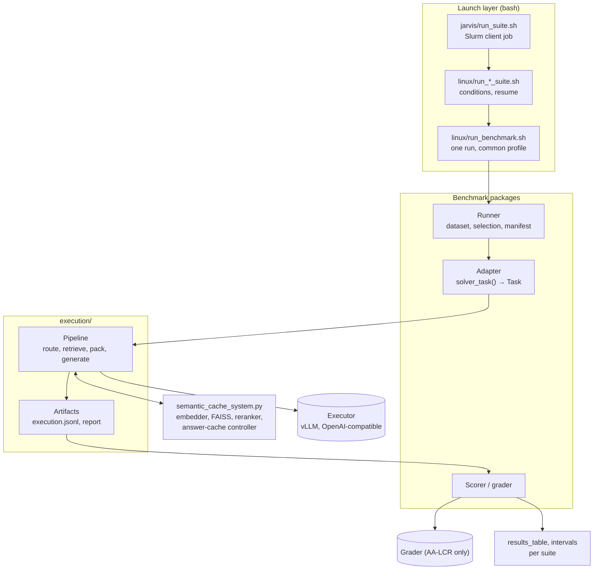
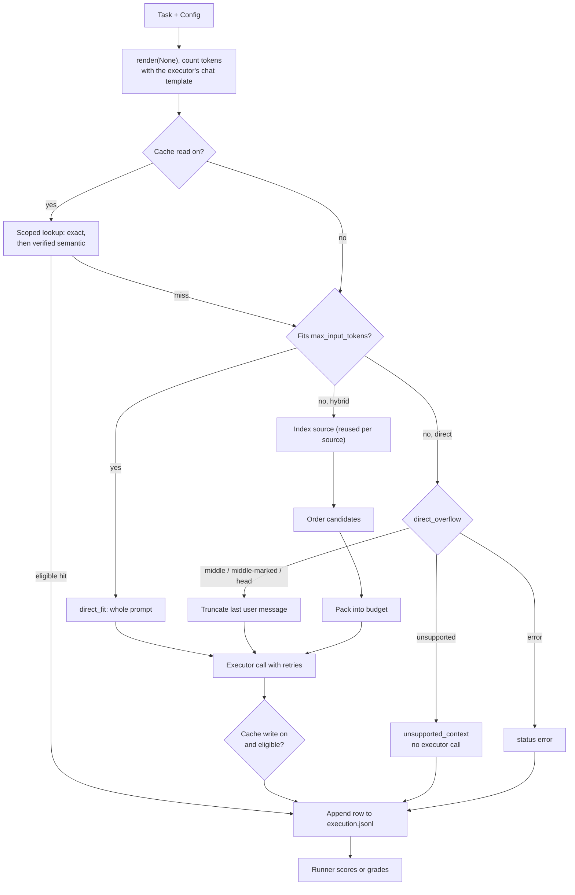

# Architecture

How the system is built as of 10 November 2026. When this page and the code
disagree, trust the code (see [AGENTS.md](../AGENTS.md)). Commands are in the
[Linux](linux/README.md) and [Jarvis suite](jarvis_suites/README.md) runbooks;
flags and defaults are in the
[runner options reference](linux/SHARED_EXECUTION_RUNBOOK.md).

## Overview

Each benchmark question comes with source text that may be longer than the
executor's input budget. One shared pipeline, `execution.pipeline.Pipeline`,
decides what the executor sees: the whole prompt when it fits, and otherwise
either a truncated prompt (direct mode) or retrieved fragments of the source
packed into the budget (hybrid mode). A benchmark plugs in through a small
adapter; scoring runs after the prediction is saved and never feeds back.

## Components

| Path | Role |
|---|---|
| `execution/contracts.py` | `Document`, `Task`, `Config`, shared CLI flags, profile resolution, fingerprints |
| `execution/pipeline.py` | `Pipeline`: preflight, cache lookup, routing, hybrid retrieval, packing, generation, per-row result |
| `execution/tokens.py` | Exact chat-template token counts, route selection, direct-overflow truncation |
| `execution/retrieval.py` | Exact-offset chunk indexing, BM25, candidate ordering, reranking, document floor, neighbour widening |
| `execution/packing.py` | Source-range verification and merging, fragment rendering, budget packing |
| `execution/client.py` | OpenAI-compatible HTTP client, retries, served-context lookup |
| `execution/cache.py` | Separate transport for the semantic-cache verifier |
| `execution/artifacts.py` | `evaluation.jsonl` records and the aggregate `execution_report.json` |
| `execution/selection.py` | Source-length filtering (`--min/max-source-tokens`) |
| `execution/results_table.py`, `execution/intervals.py` | Suite results tables and paired bootstrap intervals |
| `semantic_cache_system.py` | Embedding engine, FAISS index, reranker, `SemanticCacheController`; also the original Claude-based prototype and LongBench's iterative path |
| `aa_lcr/`, `mrcr_v2/`, `long_bench_v2/` | Dataset preparation, adapter, runner, scoring, per-benchmark tables and intervals |
| `linux/`, `jarvis/` | vLLM serving, single-run launcher, suite scripts, Slurm submission |

## The solver contract

An adapter is one `solver_task(...)` function returning a frozen `Task`. The
pipeline never branches on a benchmark name; everything benchmark-specific is
in these fields.

| Field | Meaning | How the pipeline uses it |
|---|---|---|
| `case_id`, `source_id` | Question and source identity | Row keys; questions sharing a source reuse one index |
| `documents` | Ordered `Document(id, text)` records: the retrieval corpus | Chunked, indexed, sliced back into the prompt |
| `query` | What to retrieve with | Retrieval query and answer-cache key; never changes what the model is asked |
| `render(evidence)` | Pure function returning chat messages | `render(None)`: the full prompt. `render(ranges)`: the prompt rebuilt from selected source ranges |
| `prompt_version` | Prompt-shape label | Recorded per row; part of the cache scope |
| `choices`, `required_prefix` | Checkable output form | Gate answer-cache reads and writes |
| `fixed_instructions` | Prompt text outside the corpus | Part of the cache scope |
| `legacy_docs_dir` | Pre-unification ingest | Only for the `legacy` profile |

`render(None)` must render the complete source: routing and the recorded
`full_rendered_input_tokens` come from its token count. The renderer formats
evidence the engine chose; it cannot select, reorder or extend it.
`render_document_slices` stitches selected ranges of one document and inserts
an omission marker wherever source text was skipped.

| Adapter | Documents | Prompt | Query | Output form |
|---|---|---|---|---|
| `aa_lcr/adapter.py` | Several ordered documents | Numbered documents, then the question; each document's fragments render as one block | The question | Free text |
| `mrcr_v2/adapter.py` | One conversation | Few-shot prefix + conversation + final instruction | The described request (topic and style) parsed from the instruction, or the full question with `--retrieval-query question` | `required_prefix` = the 12-character marker |
| `long_bench_v2/adapter.py` | One context | Strict MCQ system prompt, context, question and options | The question with options | `choices` = A–D |

Gold answers, needle positions and scoring metadata are never part of a `Task`,
so they cannot reach the prompt, the cache or the verifier. The one deliberate
exception is the MRCR oracle (below), which is labelled as a ceiling.

## Configuration

`Config` is a frozen record of every behaviour-affecting setting. It validates
combinations on construction and is written to `execution_manifest.json` with
a SHA-256 of its contents (`config_sha256`).

| Group | Fields |
|---|---|
| Mode and budgets | `mode` (`direct` or `hybrid`), `context_window_tokens`, `max_input_tokens`, `max_output_tokens` |
| Direct overflow | `direct_overflow`: `unsupported`, `middle`, `middle-marked`, `head`, `error` |
| Chunking | `child_tokens`, `child_overlap_tokens` (embedding-tokenizer tokens) |
| Selection | `evidence_selection` (`dense`, `bm25`, `fusion`, `random`, `position`), `selection_seed`, `rerank_top`, `neighbor_children`, `document_floor` |
| Packing | `packing` (`stop`, `skip`, `fill`), `evidence_order`, `merge_overlaps`, `exact_offsets` |
| Answer cache | `cache_read`, `cache_write`, `cache_matching` (`exact`, `semantic`) |
| Profile | `profile`: `common` or `legacy` |

Runners default to the `legacy` profile, which reproduces each runner's older
policies (evidence order, controller-side ingest, overflow and answer-cache
defaults differ by runner). The launchers pass `--execution-profile common`: exact source
offsets, source-order evidence with overlap merging, `unsupported` overflow
unless a policy is given, and answer caching off unless enabled. Everything
below describes the `common` profile.

## Request flow

`Pipeline.preflight` runs only the first two steps and reports the route a
cache miss would take, with no embedding or model calls. Every final request is
re-counted and must be within `max_input_tokens`; otherwise the row fails.

Routes recorded per row: `direct_fit`, `middle_truncated`,
`middle_marked_truncated`, `head_truncated`, `dense_child_packed`,
`unsupported_context`, and `exact_cache` / `semantic_cache` for cache hits.
Status is `ok`, `unsupported_context` or `error`; errors are saved as rows
rather than stopping the run.

### Direct overflow

`truncate_prompt` cuts only the final user message, by executor tokens, and
keeps other messages whole. `middle` keeps an equal head and tail joined
silently (the LongBench protocol); `middle-marked` puts `[... omitted ...]` at
the cut; `head` keeps the start of the documents and the text after them
(found as the common suffix of the full and evidence-free prompts, normally the
question), so only the end of the documents is lost.

### Hybrid retrieval and packing

1. **Index.** Each document is chunked with the embedding model's tokenizer
   into children of `child_tokens` with `child_overlap_tokens` overlap. Every
   child keeps its document ID and exact character offsets, verified against
   the source. Children are embedded into a FAISS index only for `dense` and
   `fusion`; a BM25 term index is built for `bm25` and `fusion`. The index is
   rebuilt only when the source content hash changes, so runners process
   questions grouped by source.
2. **Order.** All children are ranked, not a top-k:
   - `dense`: FAISS similarity to the query embedding (Qwen3-Embedding-0.6B).
   - `bm25`: BM25 (k1 = 1.2, b = 0.75) over lower-cased word tokens.
   - `fusion`: reciprocal-rank fusion of dense and BM25 (k = 60).
   - `random`: shuffled with seed `"{selection_seed}:{case_id}"`.
   - `position`: question-blind; each document's children from both ends
     inwards, documents interleaved at each depth.
3. **Adjust** (optional, in this order): rerank the first `rerank_top`
   candidates with Qwen3-Reranker-0.6B (query-ranked selections only); apply
   the document floor, which moves each document's best child to the front so
   every document is represented first; widen each candidate by
   `neighbor_children` adjacent children of the same document.
4. **Pack.** Candidates are taken in ranked order. Each is accepted if the
   prompt still fits, using cheap upper and lower token bounds and an exact
   re-render only when the bounds cannot decide, so the result matches counting
   every step. `stop` ends at the first candidate that does not fit; `skip`
   keeps trying lower-ranked ones; `fill` also trims the best remaining
   candidate's uncovered range into the leftover budget. Overlapping ranges
   merge within a document.
5. **Render.** Selected ranges are sorted into source order, checked again
   against the source text, and passed to `task.render`. The row records the
   ranges, child indices, stop reason, render count and timings.

### Answer cache

The answer cache lives in `SemanticCacheController` and is off in all current
experiments. Entries are scoped by a fingerprint of the source content, the
cache-relevant config, the executor tokenizer identity, `prompt_version`,
`choices`, `required_prefix`, `fixed_instructions` and the embedding identity,
so an answer is reused only for the same source and prompt contract. Lookup is
exact match first, then (with `semantic` matching) a nearest cached query that
a verifier model must confirm as equivalent. The verifier has its own endpoint
and model (`execution/cache.py`) and never sees reference answers. A
prediction is read from or written to the cache only if it has the required
form (non-empty, a valid choice, the required prefix) and, for writes, did not
stop on length or content filtering. Document-index reuse is separate and never
reuses answers.

### Executor client

`execution/client.py` posts to `/chat/completions` with temperature 0 and
`enable_thinking: false`, retries up to `max_retries` with the attempt count
recorded, and returns text, usage and finish reason. `served_context_window`
reads the served `max_model_len` from `/models`. Runners pass the pipeline a
`complete(messages)` callable, so tests inject fakes without a server.

## Artifacts

Each run writes to its own directory, which the runner refuses to reuse:

| File | Writer | Contents |
|---|---|---|
| `execution_manifest.json` | Pipeline | Config, `config_sha256`, executor tokenizer revision and chat-template hash |
| `embedding_manifest.json` | Pipeline (hybrid) | Embedding and reranker models, limits, device, dtype, tokenizer revision |
| `execution.jsonl` | Pipeline | One row per question: route, status, prediction, token counts, selected ranges, candidate order, timings, usage, cache fields |
| `evaluation.jsonl` | Runner | Per-question score records |
| `execution_report.json` | `artifacts.finalize` | Totals and quality by route and by source-length band; unsupported rows leave the denominator, errors score zero |
| `manifest.json`, `predictions.jsonl`, `bridge_rows.csv` | Runner | Benchmark-specific run record; suites treat a run as finished when its manifest is complete |

## Benchmarks

| Benchmark | Shared-pipeline runners | Scoring |
|---|---|---|
| AA-LCR | `aa_lcr.run_benchmark --mode direct\|hybrid` | LLM equality grader (`aa_lcr/grading.py`), CORRECT/INCORRECT. Suites run with `--execution-only` and grade afterwards with `aa_lcr.regrade`, which never regenerates answers: first with the executor model, then with `openai/gpt-5.6-luna` through OpenRouter |
| MRCR v2 | `mrcr_v2.run_benchmark --mode direct\|hybrid` | Deterministic (`mrcr_v2/scoring.py`): the upstream difflib ratio after the marker, plus exact match and prefix compliance |
| LongBench-v2 | Direct: `long_bench_v2.run_api_benchmark --api-provider openai_compatible`. Hybrid: `long_bench_v2.run_benchmark --mode baseline` with `SEMANTIC_CACHE_SEARCH_MODE=hybrid` | Parsed answer letter equals the reference |

Dataset preparation is per benchmark and pinned: AA-LCR downloads and validates
a fixed release archive; MRCR prepares selected released files and stores
token counts made with a pinned executor tokenizer revision, which runs check
against the loaded tokenizer.

Paths outside the shared pipeline: LongBench's iterative and answer-cache
modes in `long_bench_v2/run_benchmark.py` (driven by `semantic_cache_system.py`),
its RLM baseline (`run_rlm_benchmark.py`, the external `rlm` package), and its
hosted-provider direct runs (Anthropic, OpenRouter). Changes to `execution/`
do not affect them.

### MRCR oracle and visibility

`mrcr_v2/oracle.py` subclasses `Pipeline` and overrides only candidate
ordering: chunks overlapping the needle turns, located with the gold answer,
are offered first, target first; packing and rendering are unchanged. It is a
ceiling, not a method. `mrcr_v2/visibility.py` reconstructs each saved prompt
(from recorded ranges, or by re-truncating with the same tokenizer) and records
whether the target and every needle turn were whole in it.

### Analysis

Each benchmark's `results_table` module reads a suite folder and writes
`results.md` and `results.csv`, one row per condition. Each `intervals` module
calls `execution.intervals`, which computes paired differences with 95%
bootstrap intervals (10,000 replicates, fixed seed), resampling the unit that
questions share: AA-LCR document sets, LongBench-v2 documents, MRCR questions
within each conversation. All comparisons in a suite use the same replicates;
the compared pairs are listed in `execution.intervals.PAIRS`.

## Execution layer and deployment

- **Single run.** `linux/run_benchmark.sh <benchmark> <direct|hybrid>` builds
  the runner command with the `common` profile, the executor endpoint and
  model, and the dataset paths, and forwards every other argument. Hybrid runs
  put the embedding model on the GPU (`SEMANTIC_CACHE_EMBEDDING_DEVICE=cuda`).
- **Suites.** `linux/run_{aa_lcr,mrcr,longbench}_suite.sh` declare each
  benchmark's conditions as named flag sets (budgets, overflow policy,
  selection, recipe steps) and run them in sequence through
  `run_benchmark.sh` with run ID `<suite>_<condition>`. A rerun skips
  finished runs, moves unfinished folders aside,
  and ends by writing the results table. AA-LCR grades each run after it
  finishes.
- **Jarvis.** Two Slurm jobs: an executor job serving Qwen3.6-35B-A3B with
  vLLM on 4 L40S GPUs (tensor parallel 4, 262,144-token window, one sequence
  at a time, optionally pinned to a node), and a `client-gpu` suite job from
  `jarvis/run_suite.sh` with one L40S for the embedding model, which waits for
  the executor and runs the Linux suite script. `jarvis/lib/execution_services.sh`
  works out which endpoints (executor, grader, cache verifier) a run needs from
  its flags, without loading models.

| Role | Model | Where |
|---|---|---|
| Executor | `Qwen/Qwen3.6-35B-A3B` | vLLM, OpenAI-compatible |
| Embedding | `Qwen/Qwen3-Embedding-0.6B` | In the client process |
| Reranker (optional) | `Qwen/Qwen3-Reranker-0.6B` | In the client process |
| AA-LCR grader | Executor model, then `openai/gpt-5.6-luna` | vLLM; OpenRouter |
| Cache verifier (optional) | Any OpenAI-compatible model | Its own endpoint |
